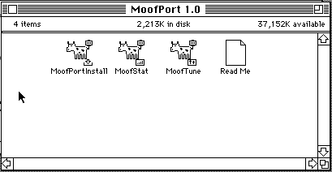
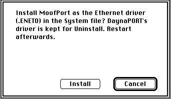
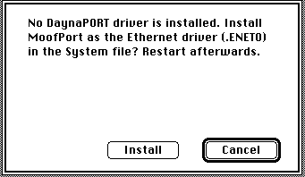
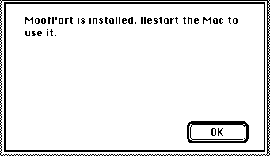
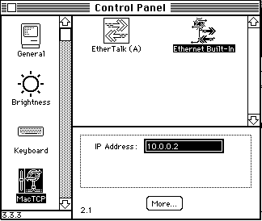
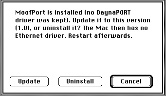
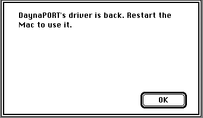

# Installing MoofPort

Check the [requirements](README.md#requirements) first. The short version: download `MoofPort-2.sit.hqx`, expand it on the Mac, open **MoofPortInstall**, click **Install**, and restart.

## Download

The release has three files. Each file contains the same four items: MoofPortInstall, MoofStat, MoofTune and Read Me. Download one file:

| File                 | Use this file when                                                                                                                                      |
| -------------------- | ------------------------------------------------------------------------------------------------------------------------------------------------------- |
| `MoofPort-2.sit.hqx` | You expand files with StuffIt Expander or StuffIt Lite on the Mac. If you are not sure, use this file. It is text, so a text transfer cannot damage it. |
| `MoofPort-2.sit`     | You expand files with StuffIt Expander or StuffIt Lite, and your transfer keeps files byte for byte.                                                    |
| `MoofPort-2.dsk`     | You use a floppy emulator, an 800K floppy disk or a Mac emulator. This file is an 800K disk image.                                                      |

`MoofPort-2.sha256` contains the SHA-256 checksums of the three files. To examine a download on another computer, use `sha256sum -c MoofPort-2.sha256`.

### Put the file on the Mac

Use one of these procedures:

- **BlueSCSI shared folder:** Copy the file into the shared folder on the BlueSCSI SD card. On the Mac, use the BlueSCSI Toolbox to copy the file to the hard disk.
- **AppleShare server:** If the Mac has a network connection now, copy the file from an AppleShare server to the hard disk.
- **Floppy disk image:** Put `MoofPort-2.dsk` on a floppy emulator, or write it to an 800K floppy disk on a different computer.

### Expand the .sit.hqx or .sit file

1. Make a new folder on the hard disk, for example "MoofPort".
2. Put the release file into this folder.
3. Open the release file with StuffIt Expander or StuffIt Lite.
4. Expand the files into the "MoofPort" folder.

NOTE: The `.sit.hqx` file is a BinHex file that contains the `.sit` file. StuffIt Expander and StuffIt Lite decode the BinHex and then expand the archive. If you get only the `.sit` file, expand it too.

NOTE: StuffIt 1.5.1 also operates on System 6. Use **Decode BinHex File** in its **Other** menu to get the `.sit` file. Then open the `.sit` file and extract the four files.

The folder then contains MoofPortInstall, MoofStat, MoofTune and Read Me.

### Use the .dsk file

1. Insert the floppy disk, or connect the disk image of the floppy emulator. The disk "MoofPort" shows on the desktop.
2. Make a new folder on the hard disk, for example "MoofPort".
3. Drag the four files from the disk "MoofPort" into this folder.
4. Eject the disk.

NOTE: The `.dsk` file is a raw 800K HFS image with no Disk Copy header. Disk Copy 4.2 cannot open it directly. Floppy emulators and Mac emulators (for example Mini vMac and Snow) open it as a floppy disk.

## Installing

CAUTION: Make a backup copy of the hard disk image before you install MoofPort. If the Mac does not start after the installation, the backup is the sure way back.

1. Shut down the Mac.
2. Remove the SD card from the BlueSCSI.
3. On a different computer, make a copy of the hard disk image file on the SD card.
4. Put the SD card back into the BlueSCSI.
5. Start the Mac.
6. Open MoofPortInstall.
7. Type a name for this run, for example the name of the Mac.
8. Click **OK**.

   NOTE: MoofPortInstall puts this name in the name of its result file, `Installer-<name>.out`.

9. Click **Install**.

   NOTE: Cancel is the default button. MoofPortInstall changes nothing until you click Install.

_If DaynaPORT is installed, MoofPortInstall keeps its driver for Uninstall._

_On a clean System with no DaynaPORT, MoofPortInstall installs MoofPort the same way._

10. When MoofPortInstall shows "MoofPort is installed", click **OK**.

11. Restart the Mac.

MoofPortInstall writes the file `Installer-<name>.out` next to itself. This file records the changes.

For MacTCP, select the Ethernet icon in the MacTCP control panel. MoofPort shows as "Ethernet Built-In". If you use EtherTalk, keep EtherTalk selected in the Network control panel.

_MacTCP 2.1 and EtherTalk both use MoofPort._

## Updating

Use this procedure if an older MoofPort version is installed. MoofPortInstall then shows **Update**.

1. Open MoofPortInstall.
2. Type a name for this run.
3. Click **OK**.
4. Click **Update**.
5. When MoofPortInstall shows the result, click **OK**.
6. Restart the Mac.

## Uninstalling

1. Open MoofPortInstall.
2. Type a name for this run.
3. Click **OK**.
4. Click **Uninstall**.
5. When MoofPortInstall shows the result, click **OK**.
6. Restart the Mac.

MoofPortInstall puts the DaynaPORT driver back exactly as it was before the installation.

CAUTION: If you installed MoofPort on a System without DaynaPORT, MoofPortInstall has no driver to put back. After Uninstall, the Mac has no Ethernet driver.

## EtherTalk without DaynaPORT disks

MoofPort supplies the `.ENET0` driver that EtherTalk uses. EtherTalk does not need the DaynaPORT disks. You must have Apple's AppleTalk Phase 2 with EtherTalk. The System 6.0.8 disks do not include it.

To install AppleTalk and EtherTalk from Apple's Network Software Installer 1.4.5:

1. Open the Network Software Installer 1.4.5.
2. Click **Customize**.
3. Select "AppleTalk v58.1.4 for System 6".
4. Select one "EtherTalk for ..." item, for example "Ethernet NB Card".
5. Click **Install**.
6. Restart the Mac.
7. Select EtherTalk in the Network control panel.

NOTE: Easy Install installs AppleTalk without EtherTalk. Use Customize.

NOTE: The DaynaPORT disk is a different source. Click **Custom Install** and select "AppleTalk v58.0.0 for System 6".

This setup was tested in the Snow emulator on a clean System 6.0.8 with no DaynaPORT software (AppleTalk 58.1.4, EtherTalk 2.5.6). AppleTalk opened MoofPort at start-up, and MacTCP operated. An AppleShare volume was not tested on this setup. The AppleShare copies under Performance used the AppleTalk and EtherTalk from the DaynaPORT disk.
