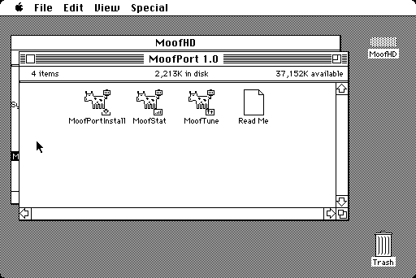
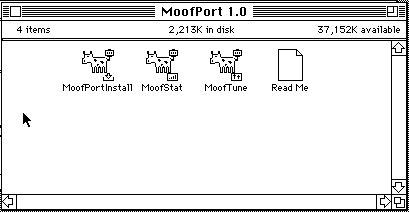
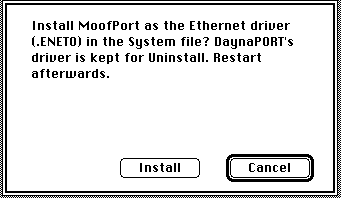
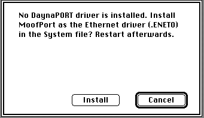
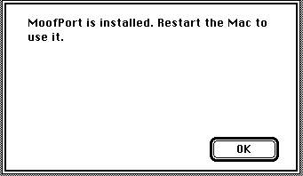
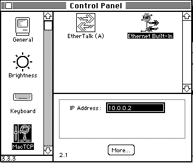
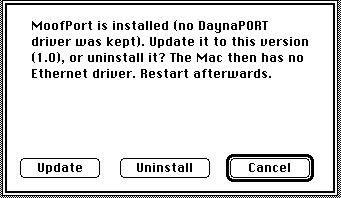
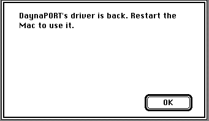

# MoofPort

**An open-source Ethernet driver for the BlueSCSI v2 Wi-Fi on a Mac Classic running System 6.0.8.**

_The MoofPort 1.0 folder, as it comes out of the archive._

## What is it?

MoofPort is a replacement `.ENET0` Ethernet driver for the **BlueSCSI v2**'s Wi-Fi (DaynaPORT
emulation) on a **Macintosh Classic** with **System 6.0.8**. It works with **MacTCP 2.1** and with
**EtherTalk / AppleShare**, at the same time, the way the driver you have now does.

It is a drop-in replacement for the `.ENET0` driver from **DaynaPORT SCSI/Link 1.2.5**. You run an
installer, restart, and your Mac is on Wi-Fi again, with the same MacTCP and AppleTalk settings.
If you ever want to go back, one click on **Uninstall** puts DaynaPORT's driver back exactly as it was.

## Why MoofPort?

Why do anything on a 35+ year old computer? :)

For years the vintage DaynaPORT SCSI/Link driver has been the way to get a vintage Macintosh onto Wi-Fi
with a BlueSCSI. It did that job well, and everyone who has a Mac Classic on a network owes it
thanks. BlueSCSI's Wi-Fi emulation speaks DaynaPORT's protocol precisely so that this driver works.

But that driver is a closed piece of software that is long out of support, and it is not
going to change. That has a cost:

- **Performance.** Nobody can tune a driver they cannot change. MoofPort receives data about **31%**
  faster than DaynaPORT on the same Mac, and AppleShare downloads are about **25%** faster, with
  uploads also ahead (numbers below).
- **Reliability.** When something goes wrong, nobody can look inside a closed driver to find out
  why. MoofPort counts what it does, and MoofStat shows you the counters.
- **Future maintenance.** New BlueSCSI firmware adds things (several packets per SCSI command, for
  one). A driver nobody can update cannot use them. MoofPort can.
- **Availability.** You should not need a long-dead, unsupported plug-in installed on your System
  just to get Ethernet. MoofPort installs on a clean System with no DaynaPORT software at all.

MoofPort keeps what worked: the same `.ENET0` interface, so MacTCP and AppleTalk cannot tell the
difference, and the same small memory footprint (within **1 KB** of DaynaPORT's). It adds source code
you can read, tests, and somebody to fix it.

## Features

- Drop-in `.ENET0` driver for MacTCP 2.1 and EtherTalk / AppleShare, at the same time.
- Faster receiving than DaynaPORT 1.2.5, and level on sending and latency (see Performance).
- Installs on a System with no DaynaPORT software. If DaynaPORT is installed, it is kept for Uninstall.
- One-click Install, Update and Uninstall (MoofPortInstall). Uninstall restores DaynaPORT's driver
  byte for byte.
- Small: about 17,500 bytes resident, within 1 KB of DaynaPORT's 16,554.
- Uses newer BlueSCSI firmware's several-packets-per-command READ and WRITE when it is there, and
  works with older firmware one packet at a time.
- MoofStat shows the driver's counters; MoofTune changes its timing until the next restart.
- Open source (MIT), with host unit tests and emulator tests.

## Requirements

- A Macintosh Classic, Plus or SE (a 68000 Mac with the same SCSI chip) with System 6.0.8.
- A BlueSCSI v2 with the Wi-Fi DaynaPORT feature. The BlueSCSI must connect to your Wi-Fi network.
- BlueSCSI firmware v2026.01 or later is recommended. This firmware can send several packets in
  one SCSI command. Older firmware also operates, with one packet in each command.
- MacTCP 2.1, AppleTalk with EtherTalk, or both.
- DaynaPORT software is not necessary. If DaynaPORT SCSI/Link is installed, MoofPort replaces its
  driver in the System file. MoofPort keeps the DaynaPORT driver for Uninstall.
- System memory: MoofPort uses 17,528 bytes. The DaynaPORT driver uses 16,554 bytes.

### EtherTalk without DaynaPORT disks

MoofPort supplies the `.ENET0` driver that EtherTalk uses. EtherTalk does not need the DaynaPORT
disks. You must have Apple's AppleTalk Phase 2 with EtherTalk. The System 6.0.8 disks do not
include it.

To install AppleTalk and EtherTalk from Apple's Network Software Installer 1.4.5:

1. Open the Network Software Installer 1.4.5.
2. Click **Customize**.
3. Select "AppleTalk v58.1.4 for System 6".
4. Select one "EtherTalk for ..." item, for example "Ethernet NB Card".
5. Click **Install**.
6. Restart the Mac.
7. Select EtherTalk in the Network control panel.

NOTE: Easy Install installs AppleTalk without EtherTalk. Use Customize.

NOTE: The DaynaPORT disk is a different source. Click **Custom Install** and select "AppleTalk
v58.0.0 for System 6".

This setup was tested in the Snow emulator on a clean System 6.0.8 with no DaynaPORT software
(AppleTalk 58.1.4, EtherTalk 2.5.6). AppleTalk opened MoofPort at start-up, and MacTCP operated.
An AppleShare volume was not tested on this setup. The AppleShare copies under Performance used
the AppleTalk and EtherTalk from the DaynaPORT disk.

## Download

The release has three files. Each file contains the same four items: MoofPortInstall, MoofStat,
MoofTune and Read Me. Download one file:

| File                   | Use this file when                                                                                                                                      |
| ---------------------- | ------------------------------------------------------------------------------------------------------------------------------------------------------- |
| `MoofPort-1.0.sit.hqx` | You expand files with StuffIt Expander or StuffIt Lite on the Mac. If you are not sure, use this file. It is text, so a text transfer cannot damage it. |
| `MoofPort-1.0.sit`     | You expand files with StuffIt Expander or StuffIt Lite, and your transfer keeps files byte for byte.                                                    |
| `MoofPort-1.0.dsk`     | You use a floppy emulator, an 800K floppy disk or a Mac emulator. This file is an 800K disk image.                                                      |

`MoofPort-1.0.sha256` contains the SHA-256 checksums of the three files. To examine a download on
another computer, use `sha256sum -c MoofPort-1.0.sha256`.

### Put the file on the Mac

Use one of these procedures:

- **BlueSCSI shared folder:** Copy the file into the shared folder on the BlueSCSI SD card. On the
  Mac, use the BlueSCSI Toolbox to copy the file to the hard disk.
- **AppleShare server:** If the Mac has a network connection now, copy the file from an AppleShare
  server to the hard disk.
- **Floppy disk image:** Put `MoofPort-1.0.dsk` on a floppy emulator, or write it to an 800K
  floppy disk on a different computer.

### Expand the .sit.hqx or .sit file

1. Make a new folder on the hard disk, for example "MoofPort".
2. Put the release file into this folder.
3. Open the release file with StuffIt Expander or StuffIt Lite.
4. Expand the files into the "MoofPort" folder.

NOTE: The `.sit.hqx` file is a BinHex file that contains the `.sit` file. StuffIt Expander and
StuffIt Lite decode the BinHex and then expand the archive. If you get only the `.sit` file,
expand it too.

NOTE: StuffIt 1.5.1 also operates on System 6. Use **Decode BinHex File** in its **Other** menu to
get the `.sit` file. Then open the `.sit` file and extract the four files.

The folder then contains MoofPortInstall, MoofStat, MoofTune and Read Me.

### Use the .dsk file

1. Insert the floppy disk, or connect the disk image of the floppy emulator. The disk "MoofPort"
   shows on the desktop.
2. Make a new folder on the hard disk, for example "MoofPort".
3. Drag the four files from the disk "MoofPort" into this folder.
4. Eject the disk.

NOTE: The `.dsk` file is a raw 800K HFS image with no Disk Copy header. Disk Copy 4.2 cannot open
it directly. Floppy emulators and Mac emulators (for example Mini vMac and Snow) open it as a
floppy disk.

## Installing

CAUTION: Make a backup copy of the hard disk image before you install MoofPort. If the Mac does
not start after the installation, the backup is the sure way back.

1. Shut down the Mac.
2. Remove the SD card from the BlueSCSI.
3. On a different computer, make a copy of the hard disk image file on the SD card.
4. Put the SD card back into the BlueSCSI.
5. Start the Mac.
6. Open MoofPortInstall.
7. Type a name for this run, for example the name of the Mac.
8. Click **OK**.

   NOTE: MoofPortInstall puts this name in the name of its result file, `Installer-<name>.out`.

9. Click **Install**.

   NOTE: Cancel is the default button. MoofPortInstall changes nothing until you click Install.

_If DaynaPORT is installed, MoofPortInstall keeps its driver for Uninstall._

_On a clean System with no DaynaPORT, MoofPortInstall installs MoofPort the same way._

10. When MoofPortInstall shows "MoofPort is installed", click **OK**.

11. Restart the Mac.

MoofPortInstall writes the file `Installer-<name>.out` next to itself. This file records the
changes.

For MacTCP, select the Ethernet icon in the MacTCP control panel. MoofPort shows as "Ethernet
Built-In". If you use EtherTalk, keep EtherTalk selected in the Network control panel.

_MacTCP 2.1 and EtherTalk both use MoofPort._

## Updating

Use this procedure if MoofPort 1.0b1 or a different older MoofPort is installed. MoofPortInstall
then shows **Update**.

1. Open MoofPortInstall.
2. Type a name for this run.
3. Click **OK**.
4. Click **Update**.
5. When MoofPortInstall shows the result, click **OK**.
6. Restart the Mac.

## Uninstalling

1. Open MoofPortInstall.
2. Type a name for this run.
3. Click **OK**.
4. Click **Uninstall**.
5. When MoofPortInstall shows the result, click **OK**.
6. Restart the Mac.

MoofPortInstall puts the DaynaPORT driver back exactly as it was before the installation.

CAUTION: If you installed MoofPort on a System without DaynaPORT, MoofPortInstall has no driver to
put back. After Uninstall, the Mac has no Ethernet driver.

## Performance

Measured on a real Mac Classic (8 MHz 68000, 4 MB, System 6.0.8, MacTCP 2.1), 2026-11-10, in one
session. DaynaPORT 1.2.5 and MoofPort 1.0 alternated in blocks (MoofPort, DaynaPORT, MoofPort,
DaynaPORT), with the drivers switched unattended, so both saw the same Wi-Fi conditions. Times are
measured on the PC, not by the Mac's clock; figures are medians. How it was measured is described
in [TESTING_METHODOLOGY.md](TESTING_METHODOLOGY.md).

|                                                   | MoofPort 1.0    | DaynaPORT 1.2.5 |                                                                                       |
| ------------------------------------------------- | --------------- | --------------- | ------------------------------------------------------------------------------------- |
| TCP receive, 1 MB                                 | 61.5 KB/s       | 46.9 KB/s       | +31% faster                                                                           |
| TCP send, one 1,400-byte send at a time           | 26.5 KB/s       | 23.0 KB/s       | level: both are set by occasional Wi-Fi loss stalls in that session                   |
| TCP send, 4 sends queued, runs with no loss stall | 45.7 KB/s       | 46.1 KB/s       | level                                                                                 |
| Echo round trip                                   | 41.6 ms         | 40.6 ms         | level                                                                                 |
| Wi-Fi frames lost, all frames the Mac sent        | 11.3 per 1,000  | 13.9 per 1,000  | same or lower                                                                         |
| Wi-Fi frames lost, full-size frames               | 16.6 per 1,000  | 21.6 per 1,000  |                                                                                       |
| AppleShare copy, 336 KB, to / from the server     | 5.0 / 21.6 KB/s | 4.0 / 17.4 KB/s | downloads +24%; uploads +27% but within run-to-run noise (Wi-Fi retries that session) |
| Resident memory                                   | 17,528 bytes    | 16,554 bytes    | within 1,024 bytes                                                                    |

- **When no packet is lost, a single stream of sends runs at about 50 KB/s for both drivers.** The
  difference you see in everyday sending is the Wi-Fi link's occasional lost packet, not the driver.
- **AppleShare copy** was measured in a second session on the same Mac (2026-11-10), with the drivers
  alternating in blocks and all 16 copies checked byte for byte. Wi-Fi retries slowed the uploads for
  both drivers in that session. Without the retry pauses, MoofPort copied at 32.6 / 25.5 KB/s and
  DaynaPORT at 28.5 / 20.0 KB/s.
- **Memory:** MoofPort's 17,528 bytes is what the Mac's `HeapInfoOpen` test reports; DaynaPORT's
  16,554 was measured on the hardware.

Receiving and file sharing are faster; sending and latency are level with DaynaPORT.

## Known issues

- **Occasional Wi-Fi packet loss:** now and then a packet is lost on the BlueSCSI's Wi-Fi link
  (about 1-2% of full-size packets in tests, varying with radio conditions). MacTCP sends it again
  after about a second, so a large transfer can pause briefly. DaynaPORT is affected equally on the
  same hardware.
- **If you hold Shift at start-up, MoofPort stays active.** MoofPort is in the System file, not
  in an extension.

## Testing methodology

See [TESTING_METHODOLOGY.md](TESTING_METHODOLOGY.md).

## Tools

MoofStat and MoofTune are described in [TOOLS.md](TOOLS.md).

## Building from source

The build uses Retro68 in Docker, and the portable core has host tests:

    scripts/build-mac.sh MoofPortInstall     # also MoofTune, MoofStat
    cmake -S . -B build && cmake --build build && ctest --test-dir build --output-on-failure
    scripts/release.sh --force 1.0           # dist/MoofPort-1.0.{dsk,sit,sit.hqx,sha256}, verified

`release.sh` also needs hfsutils, macutils, unar, gcc and Python 3.

`CLAUDE.md` lists all the commands. The release files (`.dsk`, `.sit`, `.sit.hqx`) are built by
`scripts/release.sh`; `docs/dev/RELEASE.md` describes them.

## FAQ

**Do I need DaynaPORT installed?**
No. MoofPort installs on a System with no DaynaPORT software. If DaynaPORT is installed,
MoofPortInstall keeps its driver for Uninstall.

**Do I need the DaynaPORT disks for EtherTalk and AppleShare?**
No. MoofPort supplies the `.ENET0` driver that EtherTalk uses. Apple's Network Software Installer
1.4.5 is one source of AppleTalk and EtherTalk. Use **Customize**, not Easy Install. See
"EtherTalk without DaynaPORT disks" under Requirements for the procedure and for what was tested.

**How do I go back to DaynaPORT?**

1. Open MoofPortInstall.
2. Type a name for this run.
3. Click **OK**.
4. Click **Uninstall**.
5. When MoofPortInstall shows the result, click **OK**.
6. Restart the Mac.

**Does AppleShare work?**
Yes, with EtherTalk, together with MacTCP. See Requirements for where to get EtherTalk.

**Which BlueSCSI firmware do I need?**
Firmware v2026.01 or later is recommended. This firmware can send several packets in one SCSI
command. Older firmware also operates, with one packet in each command.

**Which file do I download?**
Use `MoofPort-1.0.sit.hqx` if you are not sure. See Download.

**The Mac stops or shows a bomb at start-up.**

1. Shut down the Mac.
2. Restore the backup copy of the hard disk image (Installing, steps 1 to 4).

**The Mac starts, but the network does not operate correctly.**

1. Record the counters with MoofStat (see [TOOLS.md](TOOLS.md)). Keep the file that MoofStat writes.
2. Uninstall MoofPort (see Uninstalling).

**The Mac starts without the BlueSCSI.**
The Mac starts normally. MacTCP and AppleTalk then show that the driver is not available.

**Why is a large transfer sometimes slow?**
This is the occasional Wi-Fi packet loss (see Known issues). The DaynaPORT driver has the same
loss on the same hardware.

## TODO

- More bake-in testing on real hardware.
- Sending with several packets queued: find the occasional slow turnaround. The typical gap is
  shorter than DaynaPORT's, but the average is only level.
- Echo latency: try the `steady` setting's handling of echo-sized replies, which matched DaynaPORT.
- Direct access to the Classic's NCR 5380 SCSI chip, bypassing the SCSI Manager (high risk if the
  boot disk shares the bus, as typical on BlueSCSI).
- Wi-Fi frame loss: find which radio hop loses frames with a 2.4 GHz monitor-mode capture. Needs
  different wifi hardware.
- MoofStat: print the driver version.
- Review the BlueSCSI codebase for chances of tighter integration.
- Publish the unattended test harness (driver switching, testnet stall logging) into the main
  branch. (Stay tuned for _MoofAgent_)

## See Also

- [MoofTCP](https://github.com/matthewmrichter/mooftcp/) - A modern, memory-lean replacement for MacTCP on 68k Macs running System 6

## Credits and license

- [Retro68](https://github.com/autc04/Retro68) for the 68k cross-compiler.
- [Snow](https://github.com/twvd/snow) for the Mac emulator the tests run in.
- [BlueSCSI](https://bluescsi.com) and DaynaPORT for the network hardware this was built around.
- [Claude Code](https://claude.ai) was used to develop this project, with human planning and testing.

MoofPort is not affiliated with Apple, Dayna Communications or BlueSCSI. No Apple or DaynaPORT
code is included.

MoofPort is MIT licensed; see `LICENSE`.
