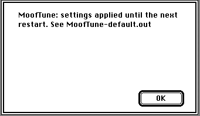

# Tools

## MoofStat

MoofStat writes the MoofPort counters (packets, errors, settings) to the file
`MoofStat-<name>.out`, next to MoofStat. If you think that MoofPort has a problem, record the
counters and keep this file:

1. Open MoofStat.
2. Type a name for this run.
3. Click **OK**.
4. When MoofStat shows "MoofStat finished", click **OK**.

## MoofTune

MoofTune changes the MoofPort timing until the next restart. To use a setting:

1. Open MoofTune.
2. Type the name of a setting from the table below as the run name.
3. Click **OK**.

| Name       | What it does                                                                                                                              |
| ---------- | ----------------------------------------------------------------------------------------------------------------------------------------- |
| `default`  | MoofPort 1.0's settings (what you get after a restart)                                                                                    |
| `noinline` | send each packet in the next network check instead of at once (1.0b1's way; fewer lost packets in some tests, slower one-at-a-time sends) |
| `steady`   | check the network every 16 ms, one packet at a time, as DaynaPORT does (receive about 30% slower)                                         |
| `tick`     | check the network once per tick, always (0.3d3)                                                                                           |
| `txpolled` | handshake every byte of each packet sent to the BlueSCSI (slower, no fewer lost packets)                                                  |
| `phase1`   | the first version's behaviour, for comparison                                                                                             |
| `quiet`    | check only every 30 s (for diagnostics)                                                                                                   |
